# Tâches 6 - Faites de votre mieux!

## Objectif et point de départ

L'objectif de cette tâche était de construire le meilleur modèle de espéres (expected goals) possibles avec toute liberté sur les modèles. 
Il était important de varier les approches plutôt que d'en pousser une seule. 

Le point de départ est le modèle XGBoost réglé de la tâche précédente. Ce modèle possède 15 caractéristiques avec les métriques suivantes : 
AUC = 0,7488, log loss = 0,2886.

Les données d'entrainement sont composées des données des saisons régulières des saisons 2016-17 à 2021-2022. L'ensemble de validation est composé
des données de la saison régulière 2022-2023. 

Un seul script (train_task6.py) contient le code pour les approches (tentatives). Chaque tentative a sa propre expéreince Wandb associée, chaque
expérience contient la configuration, les métriques, les figures et le modèle. 

## Métriques 

Les métriques utilisées pour évaluer le modèle sont les suivantes : 

- L'AUC de la courbe ROC : correspond à la capaciter à classer les tirs. C'est la probabilité qu'un but tiré au hasard reçoive une probabilité plus haute qu'un non-but tiré au hasard ; 0,5 correspond au hasard. On cherche a rapprocher la valeur de cette métrique le plus possible de 1 (la valeur maximale)
- Log loss (entropie croisée) : la moyenne de −log de la probabilité donnée à ce qui s'est réellement passé. Cette métrique est notre critère principal, on cherche a diminuer sa valeur le plus possible. 
- Score de Brier : l'écart quadratique moyen entre la probabilité et le résultat, on cherche à le minimiser. 
- L'erreur de calibration (ECE) : : les tirs sont répartis en 15 groupes de même taille selon leur probabilité. Dans chaque groupe, on mesure l'écart entre probabilité moyenne prédite et taux de buts réel, puis on fait la moyenne pondérée. On cherche a diminuer la valeur de cette métrique. 
- Ratio xG / buts : la somme des probabilités divisée par le nombre de buts réels. La valeur idéale pour cette métrique est 1. 

Pour choisir la meilleure tentative, on accorde la priorité suivante aux métriques : on vérifie le log loss en premier, puis l'ECE, le ratio et le score de Brier. On considère l'AUC comme une métrique secondaire. 

## Tentatives 

### Tentative A : xgb_features_v2

Lien Wandb : https://forge.coreweave.com/wandb/IFT3700-2026-10/ift3700-milestone-2/runs/rt7717wm

Cette tentative se base sur le XGBoost de la tache 5 avec exactement les mêmes hyperparamètres, seulement les caractéristiques changent. 7 nouvelles caractéristiques ont été ajoutées pour un total de 22 caractéristiques. Voici les 7 nouvelles caractéristiques : 

- empty_net (float, vaut 1.0 ou 0.0) : filet visé désert. 
- shooter_skaters, opponent_skaters, skater_diff (int) : patineurs de chaque équipe et différence, tirés du situationCode.
- is_home (float, vaut 1.0 ou 0.0) : l'équipe qui tire joue à domicile
- last_event_same_team (float, vaut 1.0 ou 0.0) : l'événement précédent appartient à l'équipe qui tire
- score_diff (int) : écart au score du point de vue du tireur, calculé avant le tir

Illustration de l'importance de chaque caractéristique du modèle : 
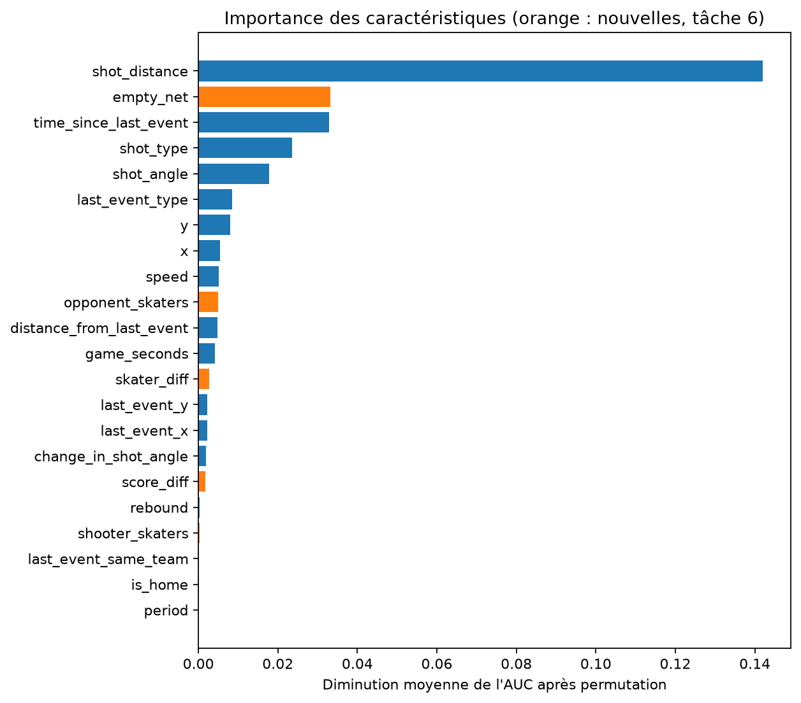

### Tentative B : xgb_tuned_v2

Lien Wandb : https://forge.coreweave.com/wandb/IFT3700-2026-10/ift3700-milestone-2/runs/smhk2uoh

Cette tentative a comme base les 22 caractéristiques de la tentative A (xgb_features_v2). Voici les changements apportés : 
- Les valeurs manquantes ne sont plus remplacées par la médiane : XGBoost les gère lui-même.
- Une recherche aléatoire de 30 configurations sur 9 hyperparamètres, dont 3 de régularisation : reg_lambda (L2), reg_alpha (L1), gamma (gain minimal pour séparer un nœud).
- L'optimisation de la log loss.
- Une validation croisée groupée par match.
- La recherche est faite sur 30 % des matchs d'entraînement, puis la meilleure configuration est réentraînée sur tout l'entraînement.

Log loss de chaque configuration essayée :
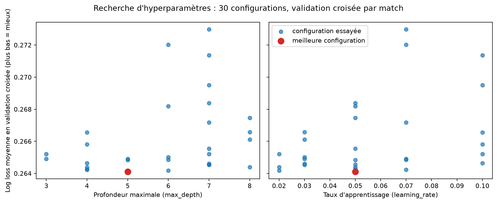

### Tentative C : autres familles de modèle

Cette tentative explore d'autres (3) familles de modèle. Les 22 caractéristiques servent toujours de base pour ces modèles. 

- hgb_v2 (HistGradientBoosting de scikit-learn) 

Lien Wandb : https://forge.coreweave.com/wandb/IFT3700-2026-10/ift3700-milestone-2/runs/xo1hf7ql

Voici les changements que ce modèle apporte : valeurs manquantes et catégories gérées nativement (les catégories sont numérotées puis déclarées comme catégorielles), arrêt précoce sur la log loss avec 10 % de l'entraînement mis de côté, le nombre d'itérations utilisées est dans iterations_used. Paramètres : taux d'apprentissage 0,05, au plus 500 itérations, 31 feuilles par arbre, 50 tirs minimum par feuille, régularisation L2 de 1,0.

- mlp_v2 (réseau de neurones)

Lien Wandb : https://forge.coreweave.com/wandb/IFT3700-2026-10/ift3700-milestone-2/runs/j39dgv3h

Deux couches cachées (64 et 32 neurones), régularisation alpha = 0,001, lots de 512 tirs.
Préparation : valeurs manquantes remplacées par la médiane, avec un indicateur « manquant » ; normalisation par quantiles,  (certaines variables comme la vitesse ont des valeurs extrêmes) ; one-hot pour les catégories.
Arrêt précoce maison, sur la log loss : 10 % des matchs d'entraînement sont mis de côté, et on garde les poids de la meilleure époque car l'arrêt précoce de scikit-learn surveille l'exactitude, qui bouge à peine avec 90 % de non-buts. 

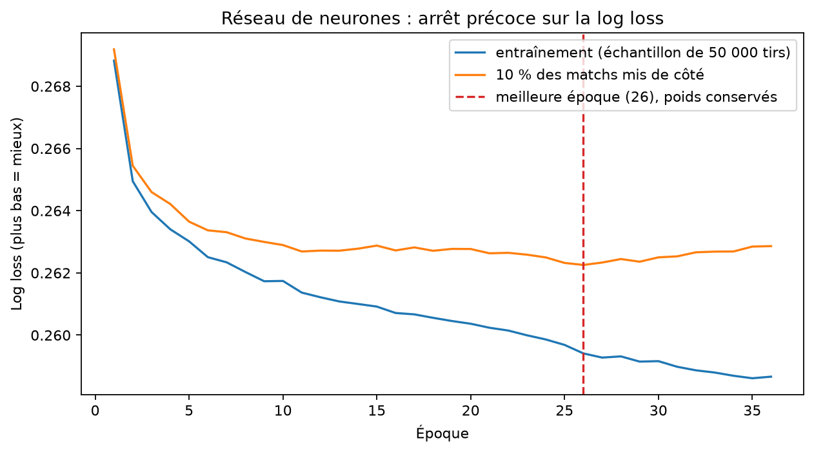

- logreg_v2 (régression logistique sur toutes les caractéristiques)

Lien Wandb : https://forge.coreweave.com/wandb/IFT3700-2026-10/ift3700-milestone-2/runs/c9kj174p

Même préparation que le réseau. Elle sert de référence linéaire.

### Tentative D : déséquilibre des classes et calibration

- xgb_weighted_v2 (pondération des buts)

Lien Wandb : https://forge.coreweave.com/wandb/IFT3700-2026-10/ift3700-milestone-2/runs/az4ecav3

Identique à A, avec scale_pos_weight = non-buts / buts, environ 9

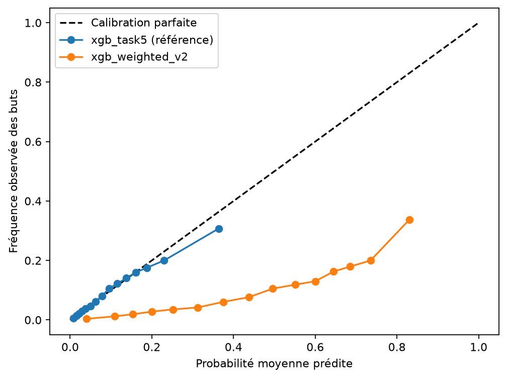

- xgb_isotonic_v2 et xgb_sigmoid_v2 (calibration)

Lien Wandb xgb_isotonic_v2 : https://forge.coreweave.com/wandb/IFT3700-2026-10/ift3700-milestone-2/runs/dpltnn04
Lien Wandb xgb_sigmoid_v2 : https://forge.coreweave.com/wandb/IFT3700-2026-10/ift3700-milestone-2/runs/bjl5o87l

Le modèle de A est entraîné sur 2016-17 à 2020-21, et la calibration est apprise sur 2021-22, une saison que ce modèle n'a pas vue. La validation 2022-23 reste intacte.

Deux méthodes : isotonique (fonction croissante en escalier, très souple) et sigmoïde (régression logistique sur le logit de la probabilité, plus lisse et plus stable).

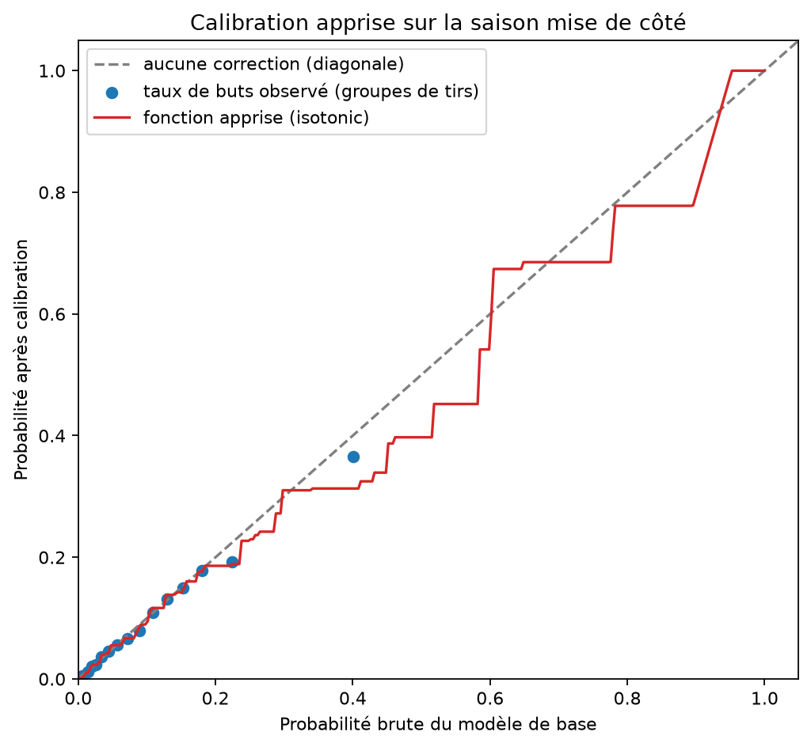

## Résultats

| Modèle | AUC ↑ | Log loss ↓ | Brier ↓ | ECE ↓ | xG / buts |
|---|---:|---:|---:|---:|---:|
| hgb_v2 | 0.7640 | 0.2785 | 0.0801 | 0.0085 | 1.065 |
| xgb_tuned_v2 | 0.7633 | 0.2787 | 0.0802 | 0.0086 | 1.065 |
| xgb_features_v2 | 0.7630 | 0.2787 | 0.0802 | 0.0084 | 1.062 |
| xgb_sigmoid_v2 | 0.7612 | 0.2792 | 0.0803 | 0.0076 | 1.019 |
| xgb_isotonic_v2 | 0.7609 | 0.2793 | 0.0803 | 0.0062 | 1.017 |
| mlp_v2 | 0.7568 | 0.2812 | 0.0807 | 0.0095 | 1.018 |
| logreg_v2 | 0.7473 | 0.2885 | 0.0830 | 0.0220 | 1.077 |
| xgb_task5 (référence) | 0.7488 | 0.2886 | 0.0833 | 0.0087 | 1.055 |
| xgb_weighted_v2 | 0.7624 | 0.6047 | 0.2140 | 0.3275 | 4.256 |

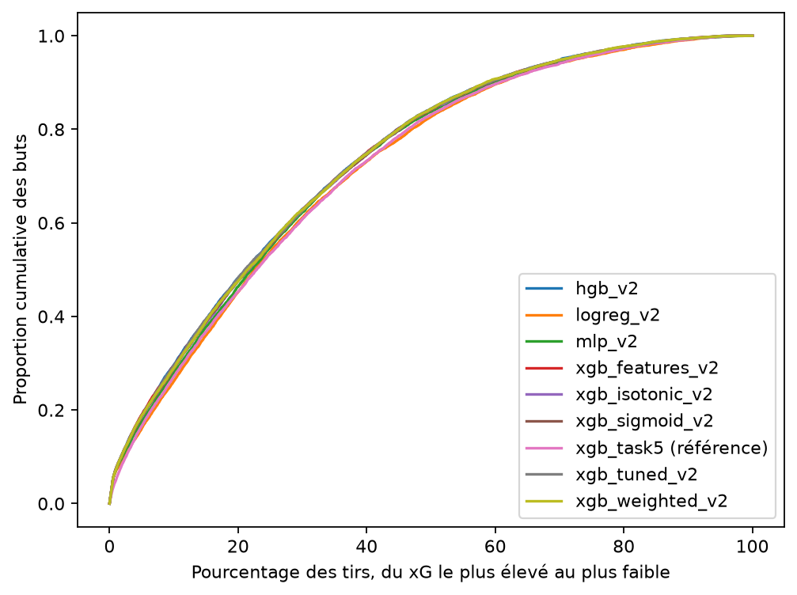
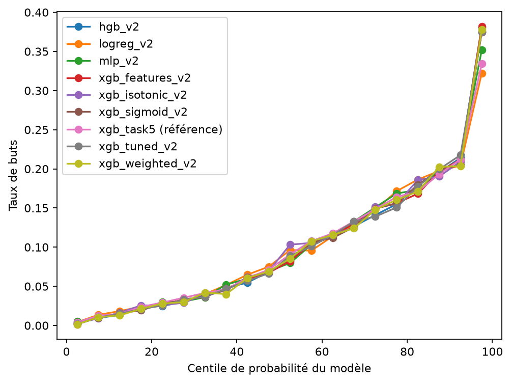
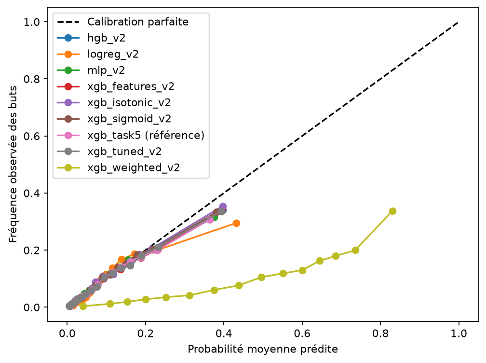
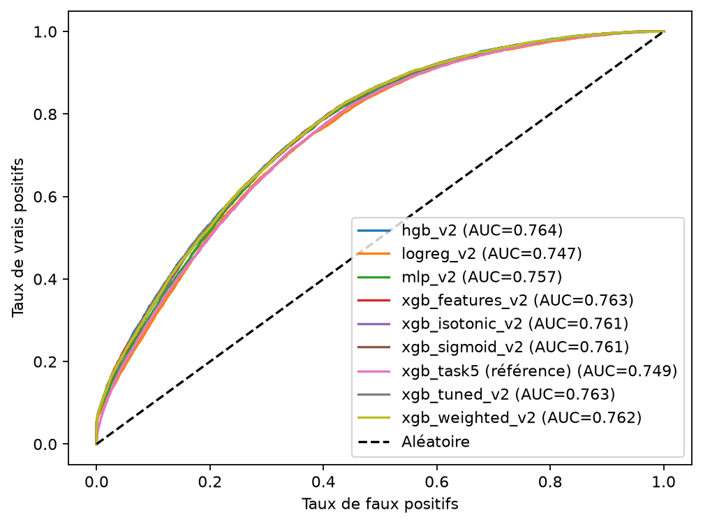

## Choix du modèle 

Nous retenons hgb_v2 (HistGradientBoosting) comme modèle final. Notre critère principal est la log loss sur la validation 2022-23, puisque ce sont les probabilités elles-mêmes qui constituent les buts espérés.
hgb_v2 obtient la meilleure log loss (0,2785) et la meilleure AUC (0,7640), contre 0,2886 et 0,7488 pour le XGBoost de référence de la tâche 5.
L'écart avec les deux XGBoost qui utilisent les mêmes caractéristiques (xgb_tuned_v2 et xgb_features_v2, 0,2787) est minime et se situe probablement dans le bruit : on peut considéré ces trois modèles à égalité. 
Ce qui les sépare, c'est donc surtout la simplicité. hgb_v2 gère nativement les valeurs manquantes et les variables catégorielles, et il n'a demandé aucune recherche d'hyperparamètres coûteuse : l'arrêt précoce choisit lui-même le nombre d'itérations.
Sa calibration est bonne (ECE de 0,0085), même s'il surestime légèrement le nombre total de buts (ratio xG/buts de 1,065), un biais que partagent tous les modèles non calibrés.
Les versions calibrées corrigent ce biais (ratio de 1,02, meilleure ECE), mais au prix d'une log loss un peu moins bonne, et nous avons privilégié la qualité globale des probabilités. 
Enfin, ce choix repose uniquement sur la validation 2022-23 : la saison 2023-24 n'a jamais été utilisée et servira à l'évaluation finale de la tâche 7.

 
 

# Tâches 7 - Évaluer sur l'ensemble de test 

## Description de la tâche 

Le principe de cette tâche est d'évaluer les modèles retenus sur les données de la saison 2023-2024, un ensemble de données qui n'a pas servi pendant l'entrainement. Les 5 modèles évalués sont les suivants : logreg_distance, logreg_angle, logreg_distance_angle, xgb_tuned_full et hgb_v2. 
Les modèles ont été évalués qu'une seule fois et n'ont pas été modifiés après l'évaluation. 

## Données de validation 

| Ensemble | Matchs | Tirs | Buts | Taux de buts | Filet désert | Distance moyenne | Tirs exclus |
|---|---:|---:|---:|---:|---:|---:|---:|
| Validation 2022-23 | 1312 | 81990 | 8248 | 10.06% | 0.54% | 35.1 pi | 0 |
| Test 2023-24, saison régulière | 1312 | 79483 | 8085 | 10.17% | 0.56% | 35.8 pi | 2 |
| Test 2023-24, séries | 88 | 4949 | 504 | 10.18% | 0.77% | 36.7 pi | 0 |

## Métriques 

Les métrqiues sont les mêmes qu'à la tâche 6 avec quelques ajouts :  
- Les intervalles de confiance à 95% par bootstrap sur les matchs, pour savoir si un écart dépasse le hasard ;
- L'écart de log loss avec le modèle final, pour comparer deux modèles évalués sur les mêmes tirs ;

## Question 1 

### Figures 

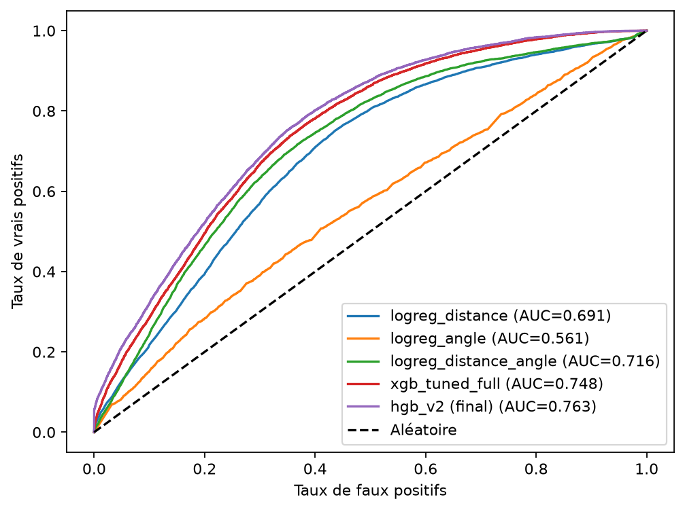
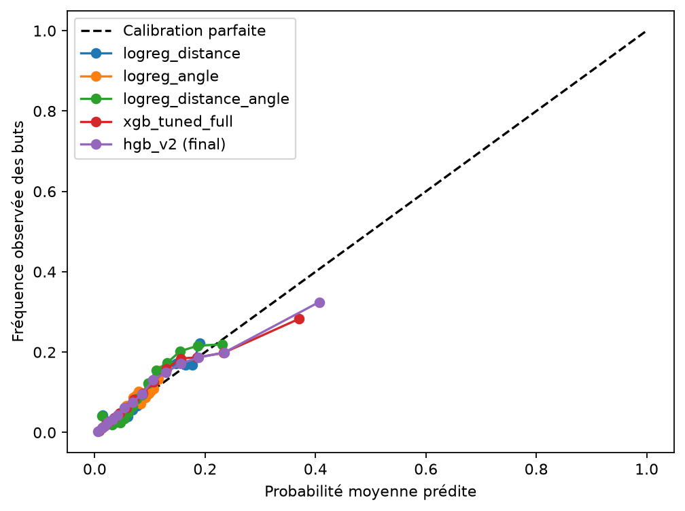
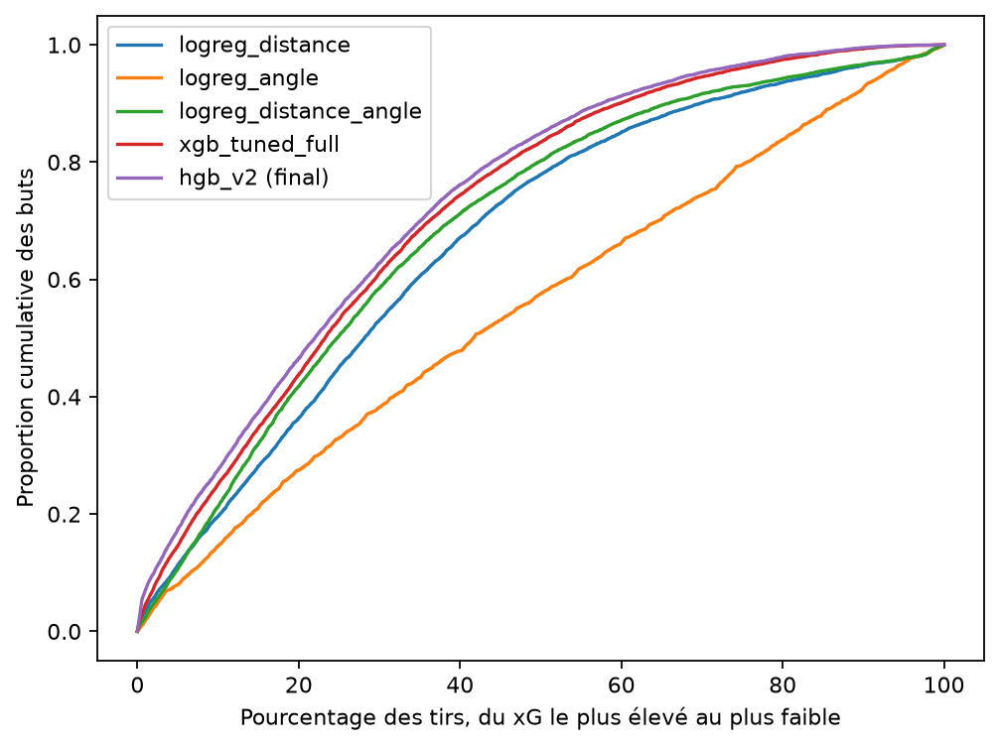
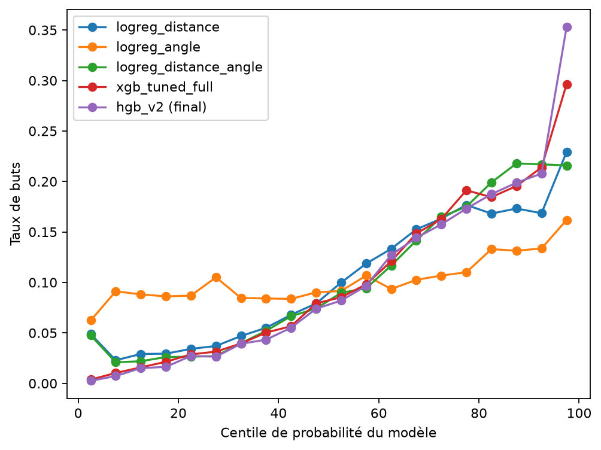

### Données test 2023-24, saison régulière

| Modèle | AUC [IC 95 %] | Log loss [IC 95 %] | Brier | ECE | xG / buts | Écart de log loss avec le final [IC 95 %] |
|---|---:|---:|---:|---:|---:|---:|
| logreg_distance | 0.6905 [0.6848, 0.6962] | 0.3124 [0.3081, 0.3171] | 0.0878 | 0.0167 | 0.949 | +0.0307 [+0.0284, +0.0330] |
| logreg_angle | 0.5610 [0.5547, 0.5686] | 0.3274 [0.3227, 0.3321] | 0.0911 | 0.0127 | 0.903 | +0.0457 [+0.0434, +0.0479] |
| logreg_distance_angle | 0.7159 [0.7105, 0.7211] | 0.3076 [0.3031, 0.3123] | 0.0869 | 0.0214 | 0.909 | +0.0258 [+0.0237, +0.0282] |
| xgb_tuned_full | 0.7480 [0.7432, 0.7529] | 0.2925 [0.2884, 0.2969] | 0.0851 | 0.0156 | 1.012 | +0.0108 [+0.0098, +0.0117] |
| **hgb_v2 (final)** | 0.7634 [0.7585, 0.7682] | 0.2818 [0.2777, 0.2859] | 0.0816 | 0.0142 | 1.025 | — |

### Analyse

Premièrement, on remarque que le modèle final (hgb_v2) généralise aussi bien qu'en validation. Nous avions une AUC de 0.7640 en validation et en test l'AUC est de  0.7634 [0.7585, 0.7682], on ne remarque pas de changement. Pour la log loss, on remarque une augmentation de 0,0033, mais cette hausse vient du taux de buts un peu plus élevé. 
On remarque que le classement original en AUC comme en log loss est le même qu'à la tâche 6 : hgb_v2 > xgb_tuned_full > logreg_distance_angle > logreg_distance > logreg_angle. Les écarts de log loss avec le modèle final sont tous positifs avec des intervalles qui n'incluent pas 0, on peut affirmer que le gain de la tâche 6 est significatif sur cet ensemble de données. 
Certains modèles semblent mieux performer qu'en validation, les régressions logistiques voient leur AUC augmenter (distance : 0,683 à 0,691, distance + angle : 0,699 à 0,716).
Les modèles à arbres surestimaient les buts en validation (ratio 1,055 et 1,065). Sur le test, la surestimation diminue : 1,012 pour xgb_tuned_full, 1,025 pour hgb_v2. Les modèles plus simples continuent à sous-estimer par rapport aux autres modèles. 
L'ECE est un peu moins bonne qu'en validation (0,0142 contre 0,0085 pour hgb_v2).
En analysant les 4 figures, on remarque la dominance du modèle hgb_v2, avec tous les résultats vus précédements, on peut affirmer qu'il s'agit du modèle le plus performant. 

## Question 2

### Figures 

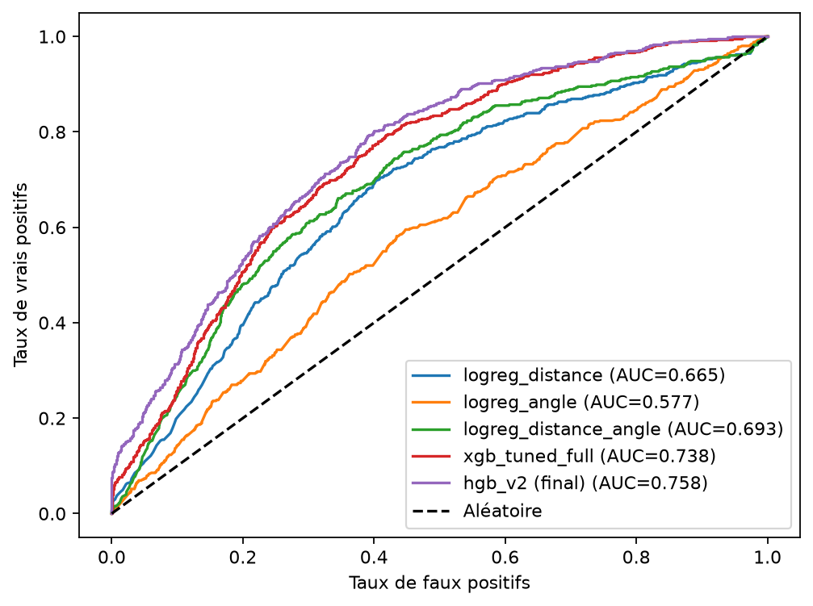
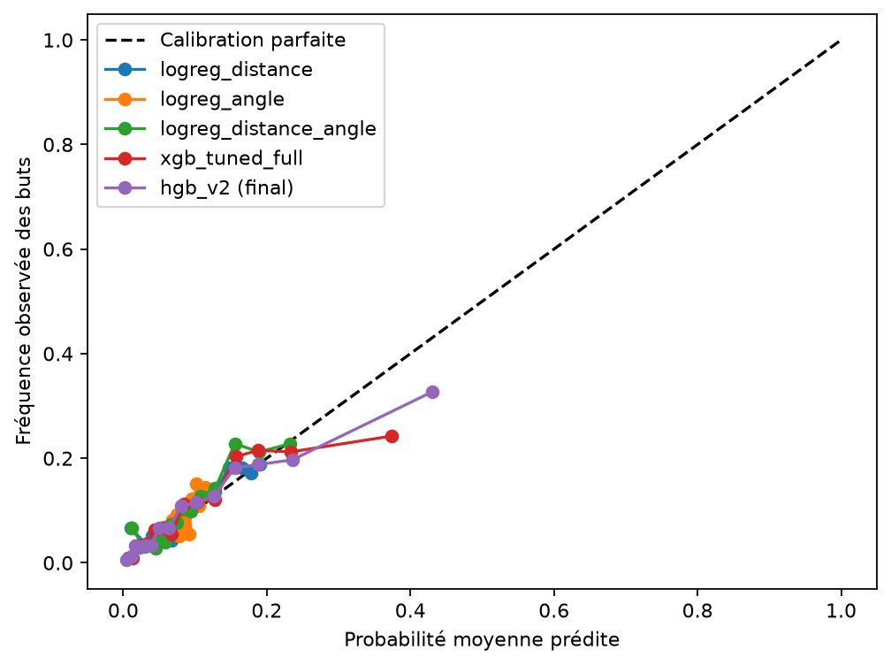
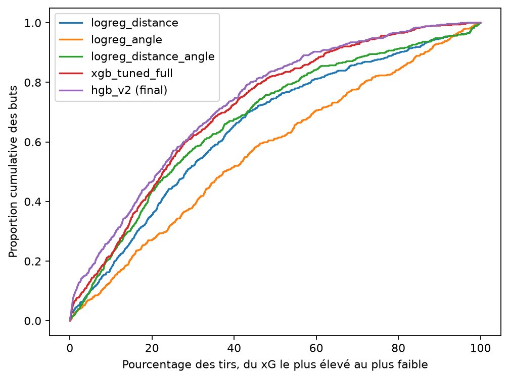
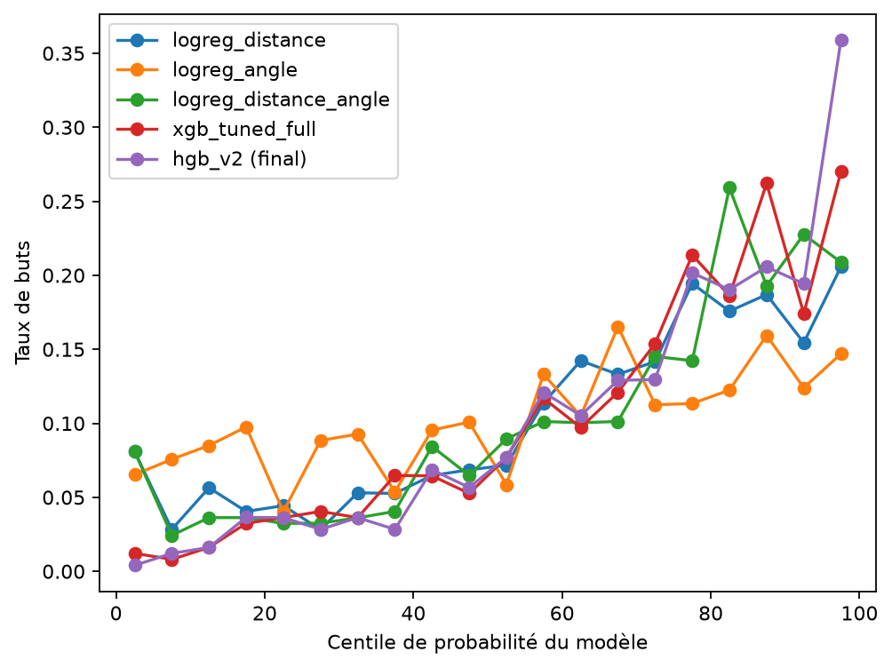

### Données test 2023-24, séries éliminatoires

| Modèle | AUC [IC 95 %] | Log loss [IC 95 %] | Brier | ECE | xG / buts | Écart de log loss avec le final [IC 95 %] |
|---|---:|---:|---:|---:|---:|---:|
| logreg_distance | 0.6651 [0.6423, 0.6900] | 0.3218 [0.3032, 0.3405] | 0.0887 | 0.0165 | 0.939 | +0.0396 [+0.0286, +0.0507] |
| logreg_angle | 0.5772 [0.5507, 0.6021] | 0.3268 [0.3098, 0.3441] | 0.0911 | 0.0206 | 0.899 | +0.0446 [+0.0362, +0.0524] |
| logreg_distance_angle | 0.6935 [0.6689, 0.7162] | 0.3160 [0.2977, 0.3358] | 0.0877 | 0.0183 | 0.893 | +0.0338 [+0.0230, +0.0446] |
| xgb_tuned_full | 0.7382 [0.7183, 0.7557] | 0.2960 [0.2789, 0.3139] | 0.0854 | 0.0233 | 1.002 | +0.0138 [+0.0099, +0.0179] |
| **hgb_v2 (final)** | 0.7577 [0.7388, 0.7745] | 0.2822 [0.2662, 0.3001] | 0.0809 | 0.0177 | 1.021 | — |

### Analyse

Pour les figures, on remarque que les courbes sont beaucoup plus irrégulières. Pour les données, on remarque que les intervalles sont plus grandes. Ces deux observations ont la même cause : l'ensemeble de données est environ 16 fois plus petit que celui de la saison régulière. Cependant, les tendances semblent être les mêmes que pour la saison régulière : les courbes du modèle hgb_v2 domine celles des autres modèles dans chaque figure. 
Pour le modèle hgb_v2, on observe des valeurs similaires à celles obtenues avec l'ensemble de test de la saison régulière : AUC 0,7577 [0,7388, 0,7745] contre 0,7634, log loss 0,2822 contre 0,2818. Contrairement au modèle final, les modèles plus simples semblent perdre en efficacité : pour le modèle logreg_distance, son AUC passe de 0,6905 à 0,6651 et pour logreg_distance_angle, de 0,7159 à 0,6935. Il est important de noter que les intervalles (saison régulière et séries) pour les modèles simples se chevauchent, on ne peut pas vraiment conclure de différence, mais il est important de noter cette baisse d'AUC. 
Comme pour la saison régulière, on remarque que le classement original en AUC comme en log loss est le même qu'à la tâche 6 : hgb_v2 > xgb_tuned_full > logreg_distance_angle > logreg_distance > logreg_angle.
Les ratios restent bons : 1,021 pour hgb_v2, 1,002 pour xgb_tuned_full, de 0,893 à 0,939 pour les régressions logistiques, qui sous-estiment toujours. Par contre, pour le modèle final et xgb_tuned_full, on remarque une ECE plus élevée (0,0177 et 0,0233 respectivement).
La généralisation aux séries est comparable pour les deux modèles à arbres, en particulier hgb_v2. La légère baisse des régressions logistiques n'est pas vraiment démontrable avec 88 matchs.
