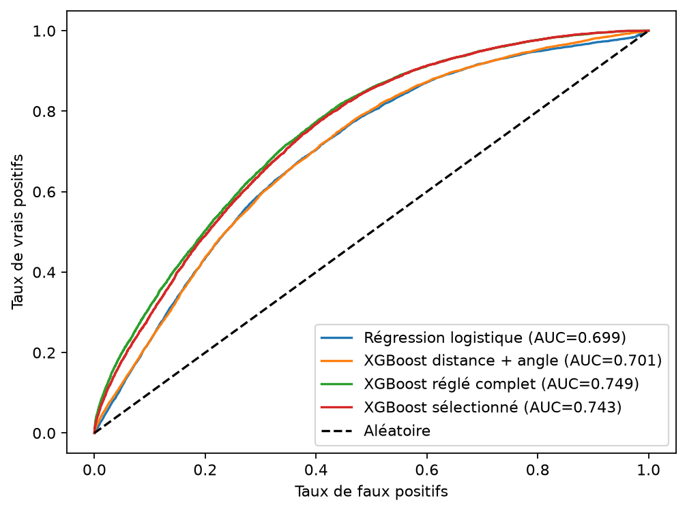
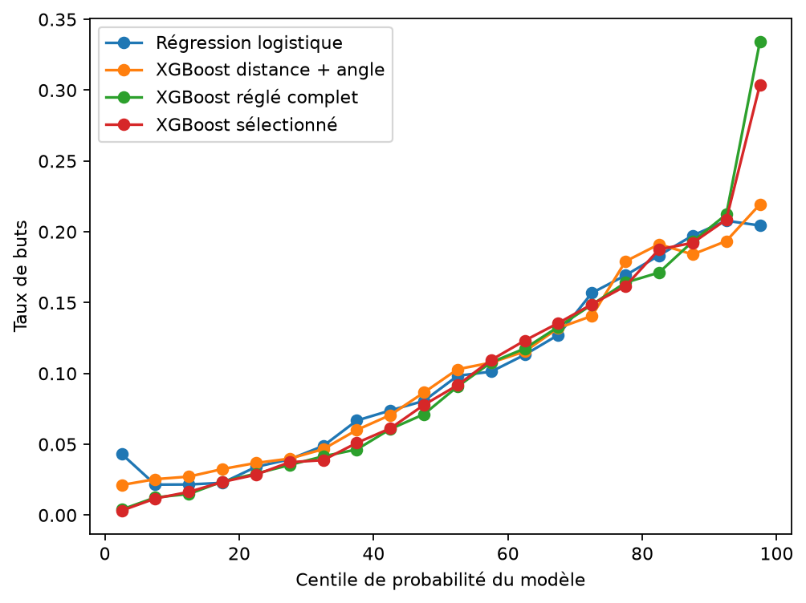
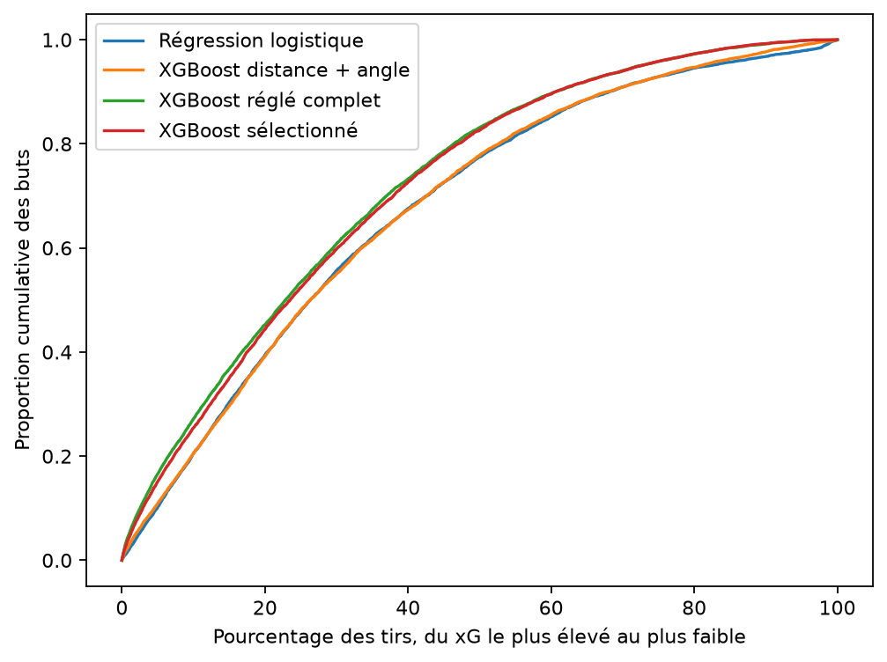
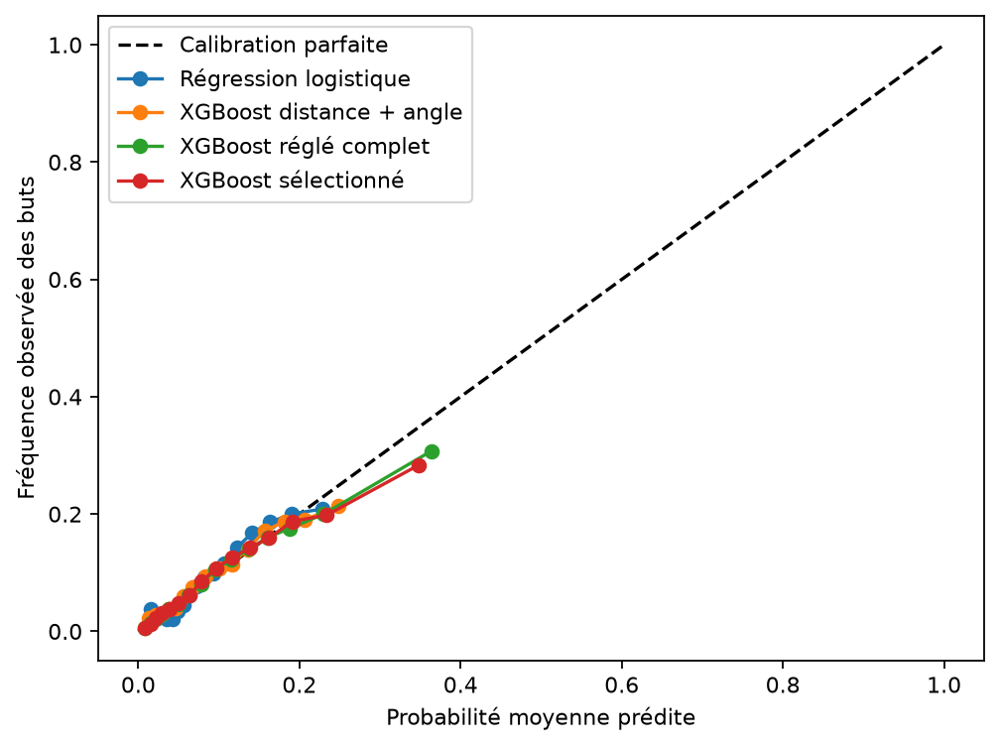
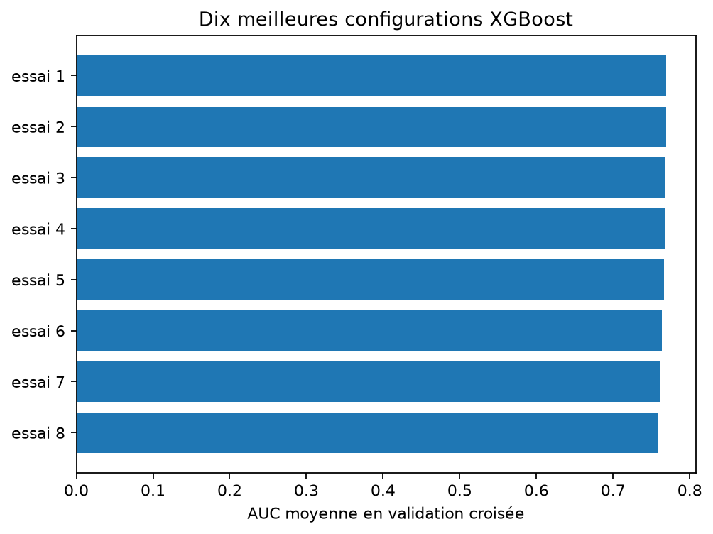
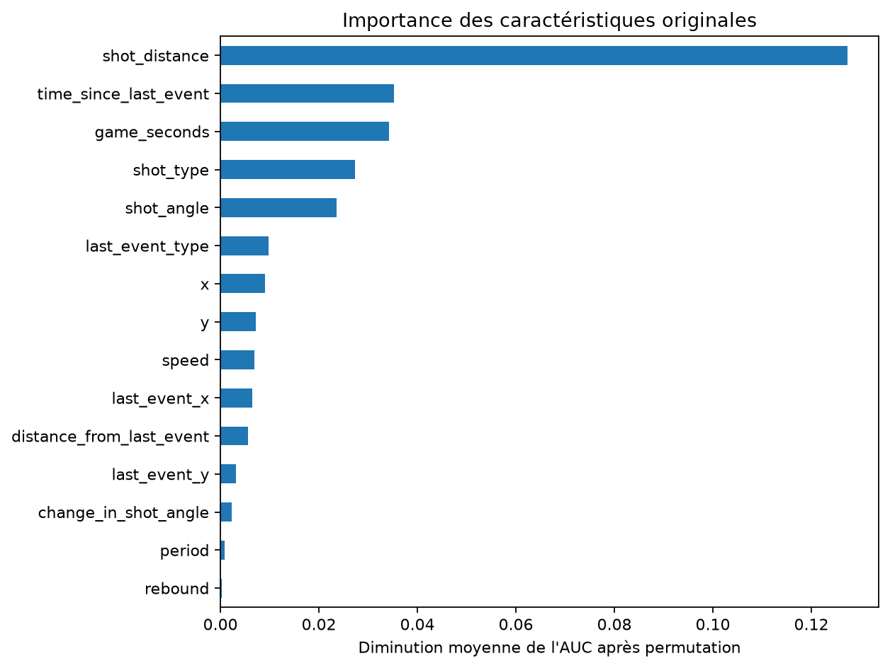

## Étape 2 — Tâche 4 : ingénierie des caractéristiques II

Nous avons conservé une ligne par tir au but ou but et réutilisé le pipeline ordonné des tâches précédentes. Pour obtenir le contexte du tir, le programme relit également la liste complète `plays` et sélectionne l'événement immédiatement précédent, quel que soit son type. Toutes les coordonnées sont orientées dans le même sens que le tir courant. Le bonus portant sur la reconstruction des pénalités n'a pas été réalisé.

### Colonnes du DataFrame

| Colonne | Description |
|---|---|
| `season` | Identifiant de la saison de la LNH. |
| `game_type` | Type de match; les modèles utilisent uniquement `2`, soit la saison régulière. |
| `game_id` | Identifiant unique du match. |
| `event_id` | Identifiant de l'événement dans le match. |
| `team` | Équipe ayant effectué le tir. |
| `game_seconds` | Secondes écoulées depuis le début du match. |
| `period` | Numéro de la période. |
| `x`, `y` | Coordonnées du tir, orientées vers le filet situé à droite. |
| `shot_distance` | Distance euclidienne entre le tir et le centre du filet `(89, 0)`, en pieds. |
| `shot_angle` | Angle absolu du tir par rapport à l'axe central du filet, en degrés. |
| `shot_type` | Type de tir fourni par le play-by-play. |
| `last_event_type` | Type de l'événement immédiatement précédent. |
| `last_event_x`, `last_event_y` | Coordonnées orientées de l'événement précédent. |
| `time_since_last_event` | Secondes écoulées depuis l'événement précédent. |
| `distance_from_last_event` | Distance euclidienne parcourue depuis l'événement précédent, en pieds. |
| `rebound` | Vrai lorsque l'événement précédent est `shot-on-goal`. |
| `change_in_shot_angle` | Changement absolu d'angle pour un rebond; zéro autrement. |
| `speed` | Distance depuis l'événement précédent divisée par le temps écoulé; manquante lorsque le temps vaut zéro. |
| `empty_net` | Indicateur de filet désert dérivé de `situationCode`, conservé manquant si indéterminable. |
| `is_goal` | Variable cible : 1 pour un but, 0 pour un tir arrêté. |

Le sous-ensemble du match Winnipeg–Washington `2017021065` est produit localement sous `milestone2_outputs/artifacts/wpg_v_wsh_2017021065.csv`. Il contient **71 événements** (66 tirs arrêtés et 5 buts), dont 11 rebonds selon la définition imposée. Les coordonnées du tir, la distance, l'angle, le type de tir et l'indicateur de filet désert sont complets. Trois événements précédents n'ont pas de coordonnées, quatre temps précédents sont indisponibles et cinq vitesses restent donc manquantes plutôt que d'être remplacées par zéro. L'artefact W&B porte exactement le nom `wpg_v_wsh_2017021065`.

**Lien W&B de l'artefact :** à ajouter après l'exécution en mode `online` dans l'espace de travail de l'équipe.

## Étape 2 — Tâche 5 : modèles XGBoost

La séparation est temporelle : les saisons régulières 2016/17 à 2021/22 forment l'entraînement et 2022/23 sert exclusivement à la validation. Conformément au périmètre retenu, les données 2023/24 ne sont ni chargées ni utilisées.

Une régression logistique distance-angle est également réentraînée avec la même séparation temporelle pour fournir une comparaison directe avec la tâche 3. Trois expériences XGBoost reproductibles sont ensuite définies :

1. **Référence XGBoost** utilisant seulement `shot_distance` et `shot_angle` avec les paramètres par défaut pertinents de `XGBClassifier`.
2. **XGBoost complet réglé** utilisant toutes les caractéristiques obligatoires de la tâche 4. Une recherche aléatoire avec validation croisée optimise le nombre d'arbres, la profondeur, le taux d'apprentissage, le sous-échantillonnage, le nombre minimal d'observations par feuille et la proportion de colonnes.
3. **XGBoost avec sélection de variables** : l'importance par permutation, calculée uniquement sur un échantillon des données d'entraînement, mesure la diminution d'AUC provoquée par la permutation de chaque colonne originale. Un modèle est réentraîné avec les variables dont l'importance est au moins médiane parmi les importances positives, en conservant toujours distance et angle. La saison de validation 2022/23 n'intervient donc dans aucune décision de sélection.

Les quatre figures produites dans `milestone2_outputs/figures/` sont :

- `task5_roc_auc.png` : courbes ROC et AUC;
- `task5_goal_rate_percentile.png` : taux de buts selon le centile de probabilité;
- `task5_cumulative_goals.png` : proportion cumulative des buts;
- `task5_reliability.png` : diagramme de fiabilité.

Deux figures justificatives supplémentaires présentent les résultats du réglage (`task5_hyperparameter_tuning.png`) et l'importance par permutation (`task5_feature_selection.png`).

### Résultats réellement obtenus

Le jeu final contient **520 564 événements** : 438 574 observations d'entraînement et 81 990 observations de validation. Une recherche aléatoire de huit configurations, chacune évaluée par validation croisée à trois plis, a retenu 250 arbres, une profondeur maximale de 5, un taux d'apprentissage de 0,07, `min_child_weight=1`, `subsample=0.9` et `colsample_bytree=0.9`.

| Modèle | AUC | Perte logarithmique | Exactitude au seuil 0,5 |
|---|---:|---:|---:|
| Régression logistique distance-angle (comparaison tâche 3) | 0,6987 | 0,3079 | 0,8994 |
| XGBoost distance-angle | 0,7012 | 0,3034 | 0,8992 |
| XGBoost complet réglé | **0,7488** | **0,2886** | **0,9005** |
| XGBoost après sélection | 0,7428 | 0,2912 | 0,8996 |

Le modèle complet obtient la meilleure discrimination et la plus faible perte logarithmique sur 2022/23. L'amélioration modeste de l'exactitude est attendue puisque les buts sont minoritaires; l'AUC, la perte logarithmique et les courbes sont donc plus informatives. La sélection a conservé `shot_distance`, `time_since_last_event`, `game_seconds`, `shot_type`, `shot_angle`, `last_event_type`, `x` et `y`. Elle réduit le nombre de variables, mais son AUC inférieure à celle du modèle complet ne justifie pas de la préférer uniquement pour la performance prédictive.

**Liens W&B :** les quatre exécutions ont été vérifiées localement en mode `offline` (l'artefact tabulaire et les trois expériences de modèles). Aucun lien public ne peut être fourni par W&B dans ce mode. Après authentification, il reste à synchroniser ou à relancer en mode `online`; le modèle de référence sera seulement journalisé, tandis que les modèles complet et sélectionné seront aussi inscrits au registre.

Cette contribution a été préparée avec l'aide de Codex. Les résultats numériques ci-dessus proviennent de l'exécution locale du pipeline complet le 21 novembre 2026.

**Références :** [consignes officielles de l'étape 2](https://github.com/milarobotlearningcourse/data_science/blob/main/milestone-2/README_fr.md), [documentation XGBoost](https://xgboost.readthedocs.io/), [documentation W&B Artifacts](https://docs.wandb.ai/models/artifacts).
